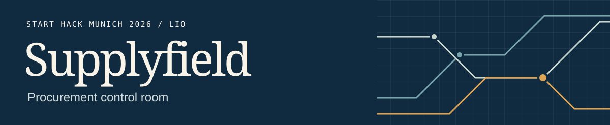
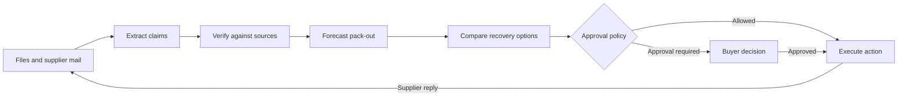

<a href="https://supplyfield.vercel.app/"></a>

**[Open the live control room ↗](https://supplyfield.vercel.app/)** · [Explore the architecture](#how-it-works) · [Run the tests](#run-the-tests)

A supplier says a shipment can leave today. Will it reach the packing line in time to save a customer order? Supplyfield reads the supplier’s reply alongside stock records, quality holds and shift capacity. It forecasts what can ship, shows which part limits production, and routes a proposed purchase to the person who can approve it.

## Walk through the live app

| Open | What to look for |
| :--- | :--- |
| [Deliveries](https://supplyfield.vercel.app/#delivery) | Start with a customer order. Compare the first forecast with the latest one and inspect the evidence behind the change. |
| [Stock and prices](https://supplyfield.vercel.app/#supply) | Follow a shortage down to the component. See usable stock, held units, purchase quantities and committed spend. |
| [Mail traffic](https://supplyfield.vercel.app/#mail) | Read a supplier exchange. Check what the supplier confirmed, what the buyer proposed and what still needs an answer. |
| [Learning environment](https://supplyfield.vercel.app/#environment) | Follow the same agents through a replay and see how a disruption changes their decisions. |

## How it works



Every step writes to a shared SQLite board. A reader attaches a source to a claim. The verifier resolves competing claims or leaves a conflict open. The planner then uses a linear program to allocate parts and packing hours. An alternative arrival time can be tested against the same inputs before anyone commits money.

| Inside the repository | Implementation |
| :--- | :--- |
| Evidence and verification | [Document readers](src/gtl/read/) · [Verifier](src/gtl/trust/) · [Board](src/gtl/board/) |
| Planning and purchasing | [Pack-out solver](src/gtl/plan/solver.py) · [Recovery options](src/gtl/resolve/) · [Approval and execution](src/gtl/govern/) |
| Supplier communications | [Mail and follow-ups](src/gtl/comms/) · [Agent playbooks](playbooks/) |
| Control room and training | [FastAPI views](src/gtl/api/) · [Web UI](web/) · [Supply chain Gym](src/gtl/gym/) |

## Run the tests

With Python 3.11 or later and `uv` installed, run these commands from the repository root. The included tests run locally without supplier credentials.

```bash
uv sync --frozen --extra dev
uv run --frozen pytest -q
```

This repository contains the application source. The existing hosted app provides the hackathon walkthrough. Running a procurement session locally requires your own tenant configuration, source records and credentials.

Built for the Lio challenge by [Edwin](https://github.com/EdwinS9), [Lucas](https://github.com/lvperasolo), [Roland](https://github.com/Rooolys) and [Bruno](https://github.com/BMittem).
